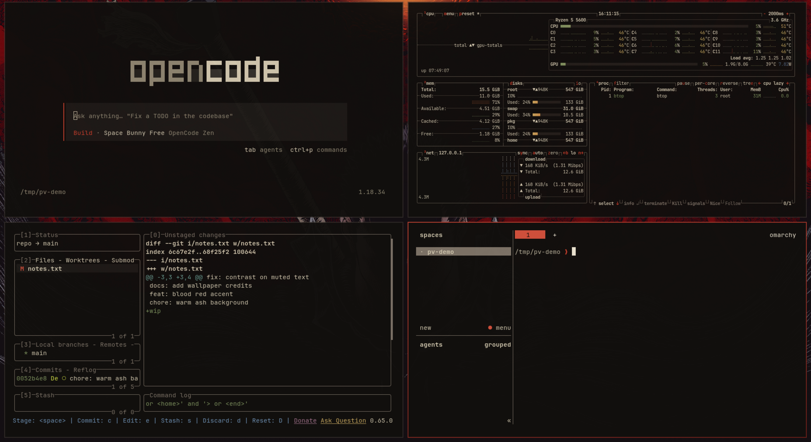

# Berserk 1997

A dark theme for [Omarchy](https://omarchy.org) inspired by the 1997 *Berserk* anime: warm ash black, parchment text,
blood red and candlelight gold.



## Install

```bash
omarchy theme install https://github.com/gustavohariel/omarchy-berserk-1997-theme
```

## Wallpapers

*Berserk* artwork © Kentaro Miura / Hakusensha, included for personal desktop use only and not
covered by the MIT licence. Rights holders: open an issue and an image will be removed.

| File | Source | Credit |
|---|---|---|
| `01-guts-amoled.jpg` | [4kwallpapers](https://4kwallpapers.com/black-dark/guts-amoled-18716.html) | NAW (metaleks.com) |
| `02-guts-colored.jpg` | [4kwallpapers](https://4kwallpapers.com/anime/berserk-guts-colored-5k-13633.html) | unknown |
| `03-guts-black.webp` | [4kwallpapers](https://4kwallpapers.com/anime/berserk-guts-black-13632.html) | unknown |
| `04-guts-gruvbox.jpg` | [WallpaperFlare](https://www.wallpaperflare.com/manga-berserk-guts-berserk-gruvbox-wallpaper-ykjvc) | Kentaro Miura; recolour unknown |
| `05-black-swordsman-forest.jpg` | [Wallhaven](https://wallhaven.cc/w/7pq2de) | unknown |
| `06-skull-knight.jpg` | [WallpaperFlare](https://www.wallpaperflare.com/berserk-guts-dark-wallpaper-ceugy) | unknown |
